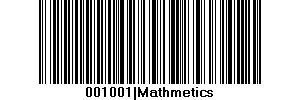
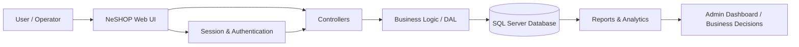
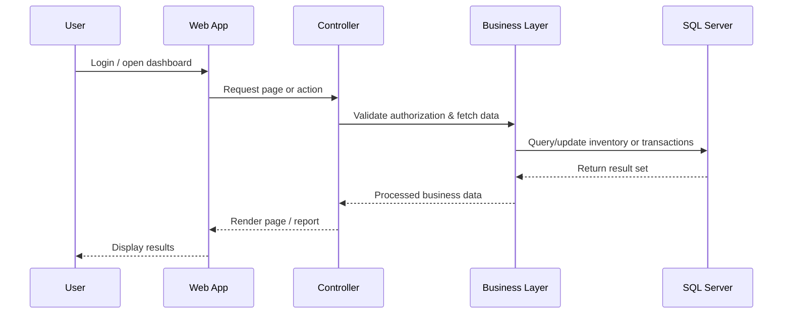

# NeSHOP 3.2

<div align="center">
  
</div>

<p align="center">
  <strong>ASP.NET Core MVC Retail Management System | Inventory | Sales | Transactions | Reporting | Administration</strong>
</p>

<p align="center">
  <a href="#overview">Overview</a> ·
  <a href="#key-features">Key Features</a> ·
  <a href="#architecture">Architecture</a> ·
  <a href="#benefits">Benefits</a> ·
  <a href="#use-cases">Use Cases</a> ·
  <a href="#getting-started">Getting Started</a>
</p>

<!-- SEO metadata for discoverability -->
<meta name="description" content="NeSHOP 3.2 is an ASP.NET Core MVC retail management software for inventory control, purchasing, sales, reporting, and admin operations in a modern web application." />
<meta name="keywords" content="NeSHOP 3.2, ASP.NET Core MVC, inventory management system, retail management software, sales tracking, accounting software, warehouse dashboard, business management, .NET 8, SQL Server e-commerce admin" />
<meta name="author" content="hasanmonsur" />

## Overview

NeSHOP 3.2 is a modern web-based business and retail management system designed for small to medium-sized enterprises that need a single platform for managing inventory, purchasing, sales, administrative tasks, and business reporting. Built with ASP.NET Core MVC and SQL Server, it gives teams a practical, centralized workflow for day-to-day operations.

This project is optimized for organizations that want a lightweight but functional solution to manage stock movement, transactions, reporting, and user access from a web dashboard.

### Why this project matters

- Inventory visibility for stock levels, stock faults, and movement history
- Sales and accounting transaction tracking in one system
- Reports for operational insights and business decisions
- Secure user and admin flows for account management
- Flexible architecture for further customization and extension

## Project Highlights

- ASP.NET Core MVC architecture
- SQL Server data integration
- Multi-module dashboard for Admin, Inventory, Transactions, and Reports
- Authentication and user role structures
- Reporting engine with printable business documents
- Session-based application workflow
- Log and monitoring support using Serilog

## Key Features

### Inventory Management
- Product and stock tracking
- Purchase and stock-in workflows
- Stock fault handling and correction
- Inventory search, reports, and movement visibility

### Sales and Transactions
- Transaction entry and processing
- Daily transaction tracking
- Voucher and invoice-oriented workflows
- Accounting-style transaction history

### Administration
- User management and admin tools
- Settings and configuration modules
- Access-decision workflows for business operations
- Role and account control

### Reporting and Analytics
- Operational reports and stock analysis
- Business performance summaries
- Invoice and transaction reporting views
- Export-ready reporting windows for decision support

### Security and Reliability
- HTTPS enforcement support
- Session-based access management
- Logging and monitoring with Serilog
- ASP.NET Core configuration for production-ready deployment

## Architecture

### Data Flow Diagram



### Sequence Diagram



## Benefits

NeSHOP 3.2 offers practical value for business teams and developers:

- Centralized operational control for inventory and sales
- Faster business decisions with reporting and analytics
- Reduced manual processing through automation of core workflows
- Improved transparency across stock movement and financial transactions
- Scalable architecture for future modules and integrations
- Clean separation of concerns between MVC layer, DAL, and data access
- Suitable for internal business systems and digital commerce workflows

## Use Cases

### Retail Store Operations
A retail business can use NeSHOP to manage stock, track sales, and generate reports across daily store operations.

### Inventory-Driven Business
Manufacturing, wholesale, and product-based businesses can monitor purchase, stock movement, and product status in one place.

### Admin and Finance Teams
Operation managers and finance teams can review transaction data, business reports, and settings without needing disconnected tools.

### Small Business ERP Workflow
NeSHOP can support a lightweight ERP-style workflow by combining inventory, transaction management, and reporting in a single web application.

## Tech Stack

- ASP.NET Core MVC
- .NET 8
- C#
- SQL Server
- Razor Views
- Serilog for logging
- Session-based user interaction
- Reporting components

## Repository Structure

```text
SHOP3.2/
├── NESHOP/
│   ├── Controllers/
│   ├── Models/
│   ├── DAL/
│   ├── Views/
│   ├── Auth/
│   ├── Contacts/
│   ├── Helpers/
│   ├── wwwroot/
│   ├── Program.cs
│   ├── appsettings.json
│   ├── NESHOP.csproj
│   └── NESHOP.sln
├── .gitignore
└── README.md
```

## Getting Started

### Prerequisites
- .NET 8 SDK
- SQL Server instance
- Visual Studio 2022 or VS Code with C# support
- IIS or local hosting environment for ASP.NET deployment

### Configuration
1. Update the database connection string in `NESHOP/appsettings.json`.
2. Ensure the target SQL Server database is available and accessible.
3. Restore any required database objects or schema in your environment.
4. Run the project via the solution file.

### Run the application

```bash
dotnet restore
 dotnet build
 dotnet run --project NESHOP/NESHOP.csproj
```

## Development Notes

This project follows the MVC pattern with controllers managing requests, models describing business logic and data objects, and views presenting user interfaces. Data access and domain logic are distributed through the `DAL` and `Contacts` layers to keep the application modular and easy to extend.

## SEO Optimization Summary

This repository is structured and written with search-friendly content to improve discoverability for terms such as:

- NeSHOP 3.2
- ASP.NET Core MVC inventory management system
- Retail management software
- Inventory and sales dashboard
- Business reporting system
- SQL Server business application
- .NET retail management project

Search-engine friendliness is achieved through:

- Clear project title and description
- Keyword-rich headings and content
- Technical stack visibility
- Structured documentation with business context
- Feature-focused language for indexing and discovery

## Screenshots

<div align="center">
  
</div>

## License

This project is shared as an open-source business application for learning, adaptation, and internal deployment. Please review all licensing and usage conditions before commercial deployment.

## Contact / Contribution

If you want to extend this project, add new modules, improve the UI, or adapt it to a specific business workflow, contributions are welcome.

---

<p align="center">
  <strong>NeSHOP 3.2</strong> — designed for smart retail operations, transparent inventory management, and business reporting.
</p>

